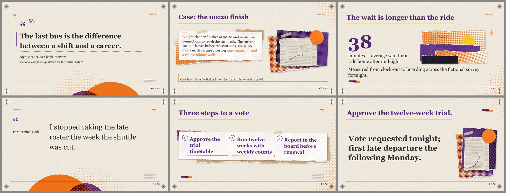
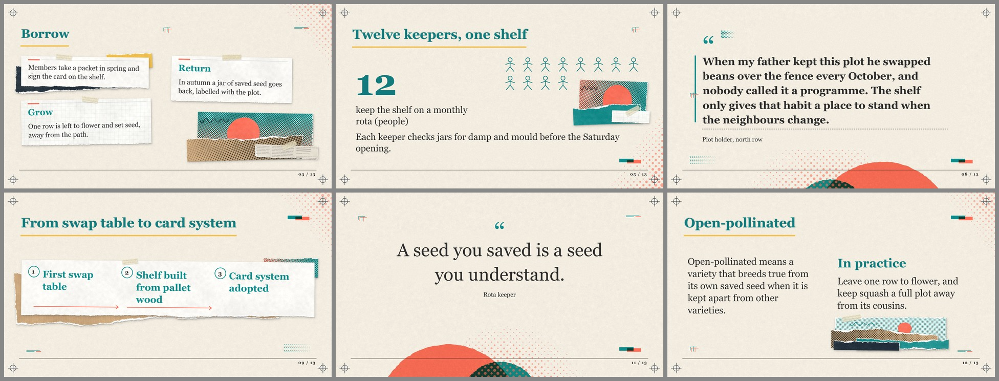
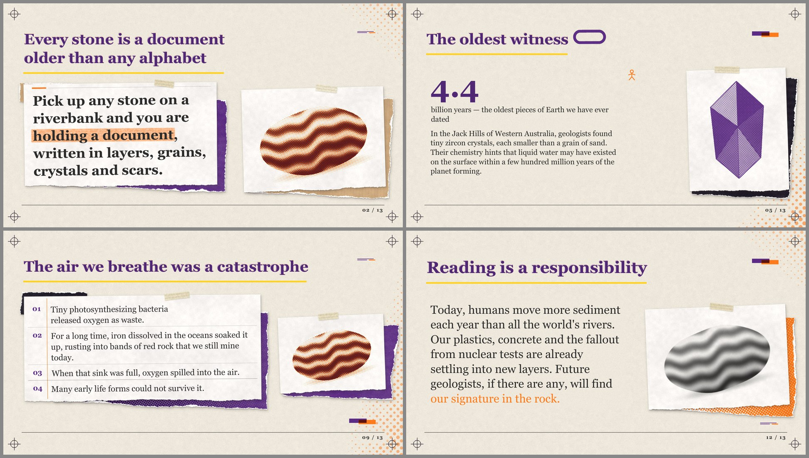
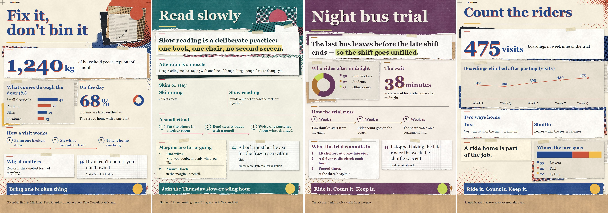

# Riso Slides v5.0

Create editable English PowerPoint decks and standalone posters with torn paper, spot inks, halftone and overprint. Version 5.0 rebuilds both workflows around short outlines, measured typography and independent slide and poster layouts.

[Download v5.0](https://github.com/Lanthanums/Risograph-Design-Skill/releases/download/v5.0/riso-slides-v5.0.zip) · [Release notes](https://github.com/Lanthanums/Risograph-Design-Skill/releases/tag/v5.0) · [中文说明](README_zh.md)

[](https://raw.githubusercontent.com/Lanthanums/Risograph-Design-Skill/v5.0/.github/gallery/night-line-slides.png)

*The Night Line* uses open paper for quotations and figures, newsprint for a rider case, and a torn sheet for the three steps to a vote. The typography and paper change with each page’s job.

## Slide gallery

[](https://raw.githubusercontent.com/Lanthanums/Risograph-Design-Skill/v5.0/.github/gallery/seed-shelf-slides.png)

*The Seed Shelf* builds a different rhythm with staggered cards, a short timeline, large quotations and small paper scenes. Lists, charts and comparisons can sit on ruled stock or newsprint, while emphasis and spot color guide the reading order. Text, chart marks and diagrams remain editable PowerPoint objects.

## From generated picture to halftone print

[](https://raw.githubusercontent.com/Lanthanums/Risograph-Design-Skill/v5.0/.github/gallery/rocks-image-treatment.png)

An agent with an image tool can generate a picture for a specific slide. The skill directs the brief toward one clear subject on a light ground, with strong light and shadow and no lettering or frame. An image supplied by the user can enter the same workflow through the outline’s `image` field.

The builder screens the picture into the deck’s spot inks and mounts it as a taped paper print. `duotone` uses both inks, `mono` uses one, and `keep` preserves the source colors. Pages without a picture can use the built-in paper scenes. *What the Rocks Remember* shows the three treatments with illustrative test artwork.

## Standalone poster gallery

[](https://raw.githubusercontent.com/Lanthanums/Risograph-Design-Skill/v5.0/.github/gallery/poster-gallery.png)

The poster builder composes one custom-sized PowerPoint page. A display masthead leads to an oversized statement or figure, followed by chart clippings, lists, steps and quotations. An ink strip carries the call to action and a kraft-paper footer holds the details. Text and data marks remain editable. The default canvas is A3 portrait, with A2, A4, square and 4:5 options.

## Get started

1. Download [the runtime ZIP](https://github.com/Lanthanums/Risograph-Design-Skill/releases/download/v5.0/riso-slides-v5.0.zip) and extract the `riso-slides/` directory into your agent’s skill root. Codex users can use `~/.codex/skills/riso-slides/` or a project’s `.agents/skills/riso-slides/`.
2. Use Python 3.10+ and install the dependencies. For full previews, configure LibreOffice and a PDF raster backend. See the [environment setup](references/harnesses.md).
3. Give the agent your source material, audience and purpose. Start at [SKILL.md](SKILL.md) and follow the [slide workflow](references/deck-workflow.md) or [poster workflow](references/poster-workflow.md). The skill authors English output and can translate supplied material when the brief allows it.

Run these commands from the extracted skill directory. Keep your outlines and outputs outside that directory. The [test kit](https://github.com/Lanthanums/Risograph-Design-Skill/releases/download/v5.0/riso-slides-v5.0-testkit.zip) includes the fictional outlines and image assets needed to try both routes.

```bash
python -m pip install -r requirements-render.txt
python scripts/doctor.py --out ../riso-output/doctor
python scripts/deck_run.py --outline ../riso-slides-testkit/night-line-outline.json --out ../riso-output/deck --auto
python scripts/poster_run.py --outline ../riso-slides-testkit/poster-repair-outline.json --out ../riso-output/poster --auto
```

The new outline form expands into a source inventory and coverage ledger, with a storyboard for decks. Existing plans and specs can still enter through the [documented input formats](references/input-formats.md). Use `--draft` for planning and `--mode audit` for a fresh render and QA. The deck’s `collage: off` and the poster’s `print: flat` offer simpler treatments. See [performance and cache](references/performance.md) for cache behavior.

The install ZIP contains the runtime, its references and dependency lists. The repository hosts the gallery. The fictional examples are available in the release test kit. Review the rendered slides or poster before delivery, including in PowerPoint when the final viewer matters.

Licensed under [MIT](LICENSE).
