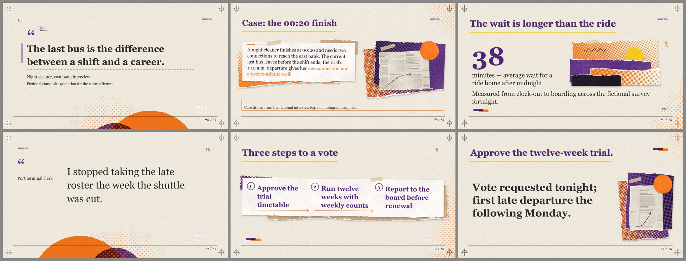
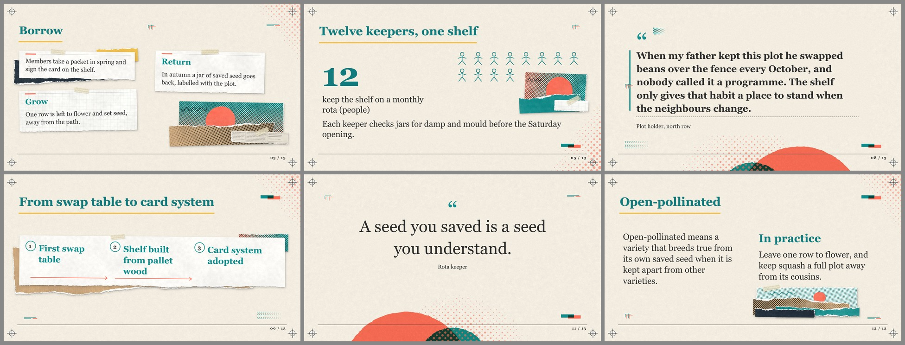
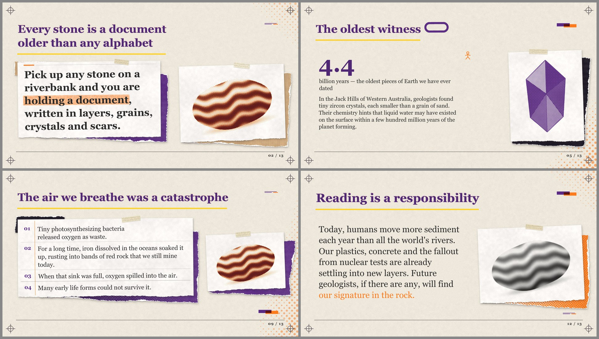
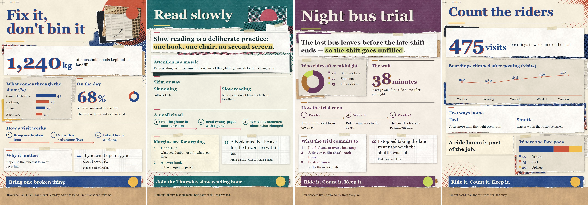

# Riso Slides v5.0

用撕纸、专色油墨、半调网点和叠印质感制作可编辑的英文 PowerPoint 与独立海报。v5.0 重构了从内容规划到出图的两条工作流，采用简短大纲、基于实际字体度量的排版，以及各自独立的幻灯片与海报版式。

[下载 v5.0](https://github.com/Lanthanums/Risograph-Design-Skill/releases/download/v5.0/riso-slides-v5.0.zip) · [发布说明](https://github.com/Lanthanums/Risograph-Design-Skill/releases/tag/v5.0) · [English](README.md)

[](https://raw.githubusercontent.com/Lanthanums/Risograph-Design-Skill/v5.0/.github/gallery/night-line-slides.png)

《The Night Line》把引语和数字留在开阔的纸面上，把乘客案例和投票步骤分别放在不同的纸张版式中。同一套配色随内容切换阅读节奏。

## 幻灯片示例

[](https://raw.githubusercontent.com/Lanthanums/Risograph-Design-Skill/v5.0/.github/gallery/seed-shelf-slides.png)

《The Seed Shelf》用错落纸卡、简短时间线、大字引语与小幅纸片场景组织叙事。列表、图表和对照内容可以落在横线纸、卡片或报纸剪贴上，重点词用专色或高亮标出。文字、图表标记和示意图保留为 PowerPoint 原生对象，可继续编辑。

## 生图与半调处理

[](https://raw.githubusercontent.com/Lanthanums/Risograph-Design-Skill/v5.0/.github/gallery/rocks-image-treatment.png)

具备生图能力的智能体可为具体页面生成插图。Skill 会约束生图构图，推荐单一清晰主体、浅色背景和鲜明光影，画面内留出空间，避免文字和边框。用户也可以通过大纲的 `image` 字段提供自己的图片。

构建器把图片按演示文稿的专色转成半调网点，再嵌入带胶带的撕边纸片。`duotone` 使用双色网点，`mono` 使用单色网点，`keep` 保留原色。没有图片的页面可以使用内置纸片场景。《What the Rocks Remember》用测试插图演示了三种处理。

## 独立海报示例

[](https://raw.githubusercontent.com/Lanthanums/Risograph-Design-Skill/v5.0/.github/gallery/poster-gallery.png)

海报用专门的构建器生成单页、可编辑的 PowerPoint。大标题和核心数字或主张带出阅读顺序，图表、步骤、列表与引语各有版式，底部用专色色条和牛皮纸区域承载行动与活动信息。默认 A3 竖版，也支持 A2、A4、方形和 4:5。

## 快速开始

1. 下载 [运行包](https://github.com/Lanthanums/Risograph-Design-Skill/releases/download/v5.0/riso-slides-v5.0.zip)，将 `riso-slides/` 解压到智能体的技能目录。Codex 可使用 `~/.codex/skills/riso-slides/` 或项目下的 `.agents/skills/riso-slides/`。
2. 使用 Python 3.10 或以上版本并安装依赖。完整预览需要 LibreOffice 与 PDF 光栅化工具，参见[运行环境](references/harnesses.md)。
3. 给智能体原始材料，并说明受众与使用场景。从 [SKILL.md](SKILL.md) 进入 [PowerPoint 工作流](references/deck-workflow.md)或[独立海报工作流](references/poster-workflow.md)。成品语言为英文，任务允许时可从其他语言翻译。

在解压后的技能目录中运行以下命令，大纲和成品放在技能目录之外。[测试包](https://github.com/Lanthanums/Risograph-Design-Skill/releases/download/v5.0/riso-slides-v5.0-testkit.zip)提供虚构素材和两条工作流的示例大纲。

```bash
python -m pip install -r requirements-render.txt
python scripts/doctor.py --out ../riso-output/doctor
python scripts/deck_run.py --outline ../riso-slides-testkit/night-line-outline.json --out ../riso-output/deck --auto
python scripts/poster_run.py --outline ../riso-slides-testkit/poster-repair-outline.json --out ../riso-output/poster --auto
```

简短大纲会展开成来源清单与内容覆盖记录，幻灯片还会生成分镜。已有计划和规格可按[输入格式](references/input-formats.md)继续使用。`--draft` 用于规划，`--mode audit` 重新构建、渲染并检查。幻灯片可用 `collage: off`，海报可用 `print: flat` 切换到更简洁的版式。缓存行为见[性能说明](references/performance.md)。

运行包包含脚本、参考文档和依赖清单。画廊图片随仓库保存，示例素材可从 Release 下载。交付前请逐页查看预览，需要在 PowerPoint 中放映时也请检查原文件。

采用 [MIT 许可证](LICENSE)。
